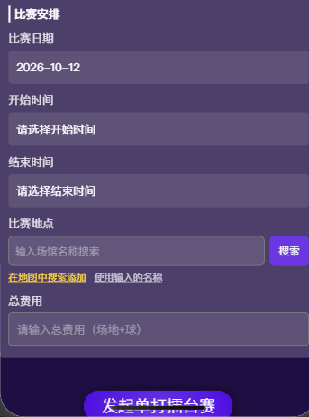
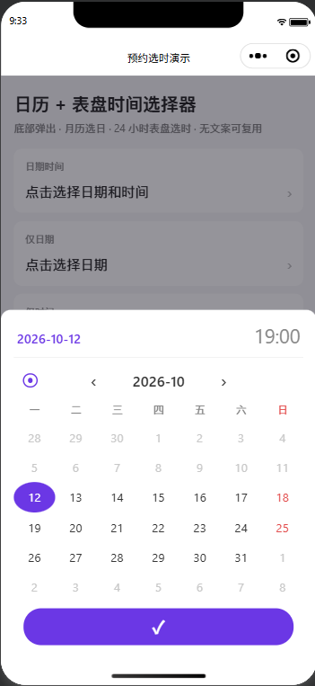
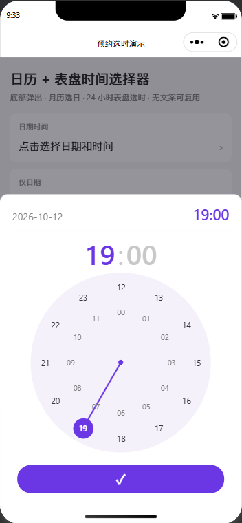
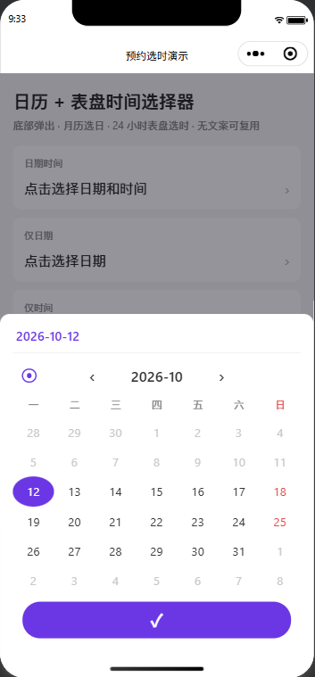
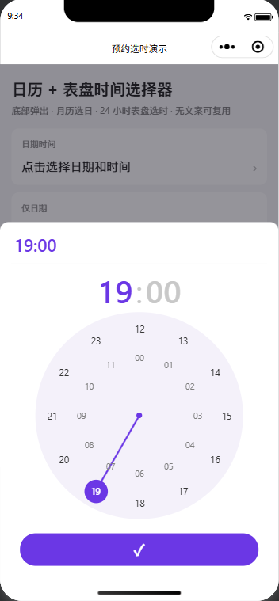
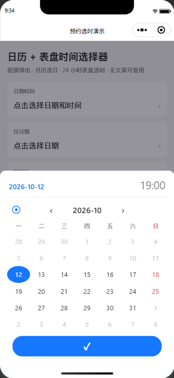
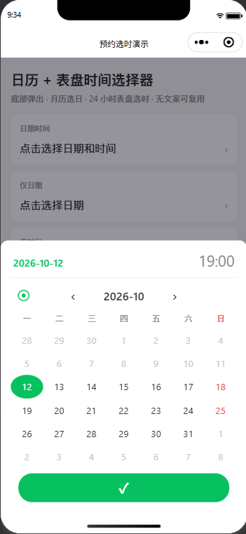
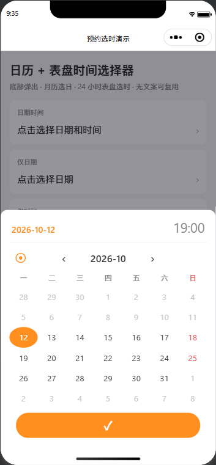
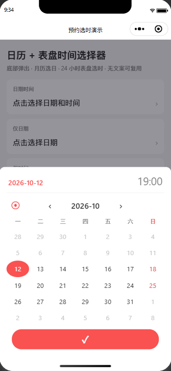

# 微信小程序预约选时 · 日历 + 表盘时间选择器

面向**约赛 / 订场 / 活动报名 / 预约到店**场景的底部弹出日期时间组件：

- 月历选日期（支持最小/最大日期）
- 24 小时双圈表盘选时间（分钟步进可配）
- 界面以数字与符号为主，几乎无文案，易嵌入多语言项目
- 零云函数依赖，复制即可用

> 本仓库是可运行的演示小程序 + 可拆走的组件。组件免费开源（MIT）；若需要整站预约/运动小程序搭建或定制，见文末「合作与定制」。



| 月历选日 | 表盘选时 | 仅日期 | 仅时间 |
|---|---|---|---|
|  |  |  |  |

主题色一个属性即可切换：

| 蓝 | 绿 | 橙 | 红 |
|---|---|---|---|
|  |  |  |  |

## 为什么不用原生 picker

| | 原生 `picker` | 本组件 |
|---|---|---|
| 日期 | 滚轮，难一眼看整月 | 月历，适合约赛/订场 |
| 时间 | 滚轮 | 表盘，更接近「选钟点」习惯 |
| 范围限制 | 有，但体验一般 | `min-date` / `max-date` 灰显不可点 |
| 多语言 | 跟系统 | 默认无长文案；星期可用 `weekdays` 传入 |

## 快速预览

1. 用[微信开发者工具](https://developers.weixin.qq.com/miniprogram/dev/devtools/download.html)打开本仓库根目录  
2. AppID 可先用测试号  
3. 编译后打开「预约选时演示」页，分别试：日期时间 / 仅日期 / 仅时间  
## 嵌入你的项目（约 1 分钟）

### 方式一：npm 安装（推荐）

1. 在小程序项目根目录（`package.json` 所在处）安装：

```bash
npm install mp-datetime-sheet
```

2. 微信开发者工具菜单「工具 → 构建 npm」

   若 `package.json` 在项目根目录、小程序代码在 `miniprogram/` 子目录，需在 `project.config.json` 的 `setting` 中配置：

   ```json
   "packNpmManually": true,
   "packNpmRelationList": [
     { "packageJsonPath": "./package.json", "miniprogramNpmDistDir": "./miniprogram/" }
   ]
   ```

3. 页面 `json` 注册：

```json
{
  "usingComponents": {
    "datetime-sheet": "mp-datetime-sheet/index"
  }
}
```

### 方式二：复制源码

1. 复制 `miniprogram/components/datetime-sheet/` → 你的小程序 `components/datetime-sheet/`
2. 页面 `json` 注册：

```json
{
  "usingComponents": {
    "datetime-sheet": "/components/datetime-sheet/index"
  }
}
```

### 页面使用（两种方式相同）

```html
<datetime-sheet
  show="{{dtShow}}"
  mode="datetime"
  date-value="{{date}}"
  time-value="{{time}}"
  min-date="{{minDate}}"
  step-minutes="{{5}}"
  bind:confirm="onDtConfirm"
  bind:close="onDtClose"
/>
```

```js
onDtConfirm(e) {
  // e.detail = { date: 'YYYY-MM-DD', time: 'HH:mm', datetime: 'YYYY-MM-DD HH:mm' }
  this.setData({
    date: e.detail.date,
    time: e.detail.time,
    dtShow: false
  });
},
onDtClose() {
  this.setData({ dtShow: false });
}
```

组件不会自己关闭，请在 `confirm` / `close` 后把 `show` 设为 `false`。

## 属性

| 属性 | 类型 | 默认 | 说明 |
|---|---|---|---|
| show | Boolean | false | 是否显示 |
| mode | String | `datetime` | `datetime` / `date` / `time` |
| date-value | String | 今天 | `YYYY-MM-DD` |
| time-value | String | `19:00` | `HH:mm` |
| min-date / max-date | String | 空 | 可选范围 |
| step-minutes | Number | 5 | 分钟刻度 |
| week-start | Number | 1 | `0`=周日，`1`=周一 |
| weekdays | Array | 日一二三四五六 | 7 项，从周日开始 |
| theme-color | String | 空（`#6B37E5`） | 主色：选中日期/小时、表针、确认按钮 |
| theme-color-soft | String | 空（`#f4f1fa`） | 表盘圆形底色 |

## 事件

- `confirm`：`{ date, time, datetime }`
- `close` / `cancel`：关闭面板

## 主题色

两种方式，任选其一，无需改组件源码。

方式一：属性传入（单个页面换色）

```xml
<datetime-sheet theme-color="#1677FF" theme-color-soft="#EAF2FF" ... />
```

方式二：CSS 变量（全局统一换色，写在 `app.wxss` 的 `page` 上）

```css
page {
  --dt-primary: #1677FF;
  --dt-primary-soft: #EAF2FF;
  --dt-sunday: #e24b4b;
}
```

| 变量 | 默认值 | 用途 |
|------|--------|------|
| `--dt-primary` | `#6B37E5` | 主色（含确认按钮，纯色） |
| `--dt-primary-soft` | `#f4f1fa` | 表盘圆形底色 |
| `--dt-sunday` | `#e24b4b` | 周日列文字色 |

属性优先于全局变量；都不设置时使用默认紫色。

## 适用场景

- 网球 / 羽毛球约赛、擂台赛选时  
- 场馆订场、课程预约  
- 活动接龙、报名截止时间  
- 到店预约、面诊排期  

组件本身免费；完整「预约 + 支付 + 管理后台」属于定制开发范围。

## 合作与定制

如果你需要：

- 运动约赛 / 场馆订场 / 活动报名小程序整包  
- 把本组件接入现有项目并统一主题  
- 云开发（云函数 + 数据库）预约与通知  

欢迎联系（请注明场景与城市）：

- 邮箱：`deserteagle369@163.com`  
- （可选）在 Issue 里留言，看到会回复  

## 目录结构

```text
mp-datetime-sheet/
├── miniprogram/
│   ├── components/datetime-sheet/   # 可单独复制走的组件
│   └── pages/demo/                  # 演示页
├── docs/
│   └── screenshots/                 # 截图 / GIF
├── project.config.json
├── LICENSE                          # MIT
└── README.md
```

## 许可

[MIT](./LICENSE)。可商用、可修改；上线前请自行完成小程序合规与备案要求。
